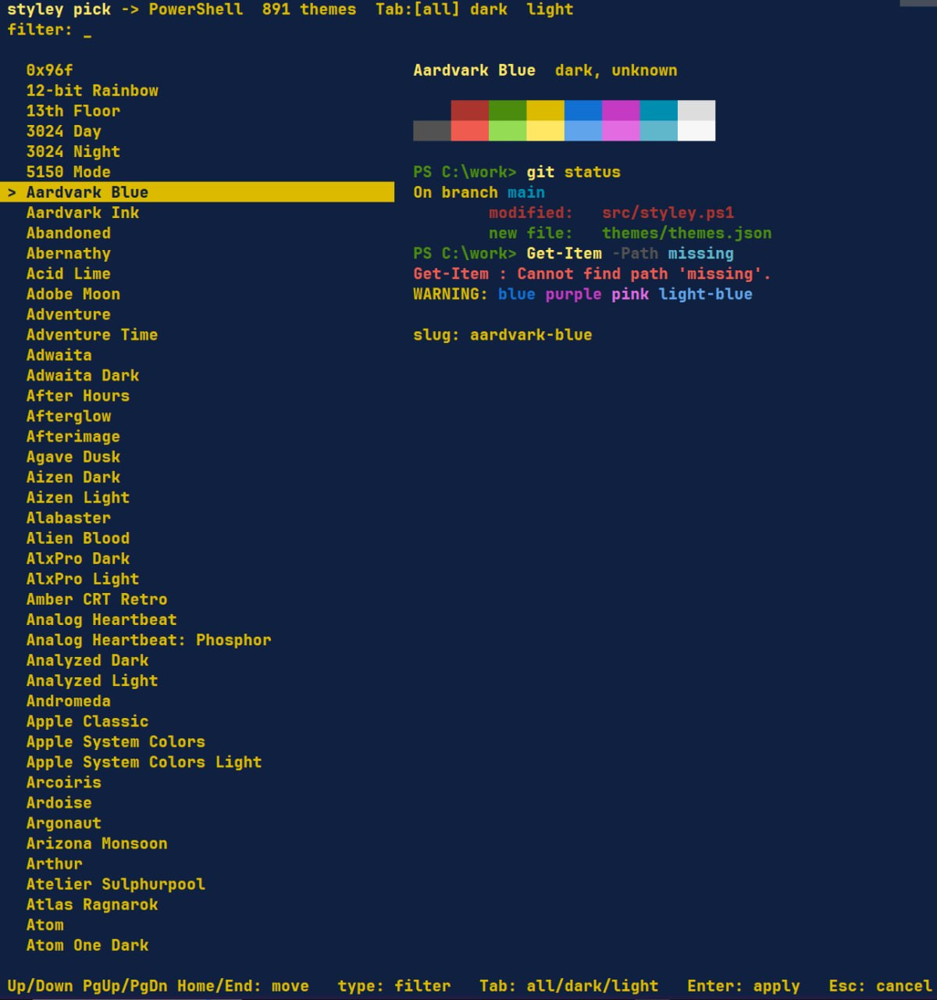
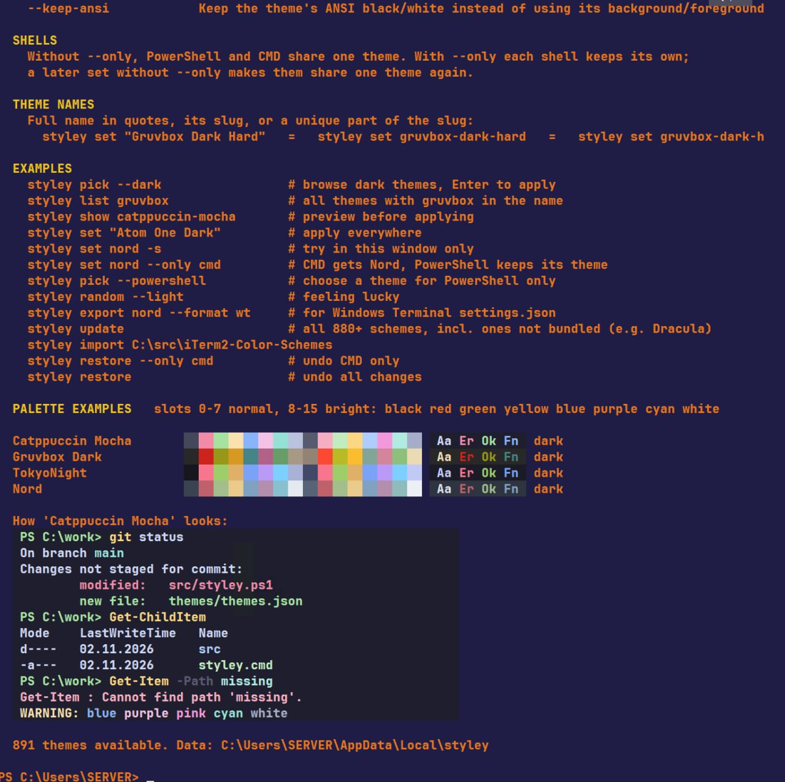

# StyleyShell: `styley`

Colour themes for **Windows PowerShell** and **CMD** in the classic console window (conhost), picked
the way you pick them in iTerm2: browse a list, watch the window change colour, and press Enter.

It uses the schemes from [iTerm2-Color-Schemes](https://github.com/mbadolato/iTerm2-Color-Schemes).
288 schemes with a free licence are bundled, and `styley update` downloads the full collection of 880+ schemes.

```
styley pick --dark          # browse dark themes; the window recolours as you move; Enter applies
styley show nord            # preview: a mock session in the theme's colours + its 16-colour palette
styley set "Gruvbox Dark"   # apply to PowerShell and CMD: this window, new windows, shortcuts
styley set nord --only cmd  # a separate theme for CMD; PowerShell keeps its own
styley restore              # undo everything
```

## Screenshots

`styley pick`: the theme list on the left; on the right, the palette and a sample session in the selected theme.



`styley help`: examples, palettes of popular themes and a sample session in Catppuccin Mocha.



## Install

Requirements: Windows 10 1703 or later and Windows PowerShell 5.1, which ships with Windows. No admin rights are needed.

```bat
git clone https://github.com/kolandor/StyleyShell.git
cd StyleyShell
install.cmd
```

This copies the tool to `%LOCALAPPDATA%\Programs\styley` and adds it to your user `PATH`. Open a new window and
run `styley help`.

`install.cmd -Dev` puts the repository's `bin` folder on `PATH` instead of copying it, so your edits apply at once.

`styley` is a `.cmd` file that starts PowerShell with `-ExecutionPolicy Bypass`, so it works from CMD and from
PowerShell the same way, even when the execution policy is `Restricted`.

## Uninstall

```bat
uninstall.cmd
```

The uninstaller does three things, in this order:

1. **Restores the original console colours of both shells**, the same way as `styley restore`: it brings back the
   registry values and the shortcuts saved before styley's first change. This works whether PowerShell and CMD shared one
   theme or had separate ones. If styley never changed anything, it skips this step.
2. Removes styley from the user `PATH` and deletes `%LOCALAPPDATA%\Programs\styley`. It removes both the normal and the `-Dev` install.
3. Keeps your user data in `%LOCALAPPDATA%\styley`: imported themes and the backup.

| Option | Effect |
|---|---|
| `-KeepColors` | Keep the themes of both shells; only remove the program |
| `-KeepColorsFor powershell` / `-KeepColorsFor cmd` | Keep the theme of that shell; restore the other one |
| `-Purge` | Also delete `%LOCALAPPDATA%\styley`. It is kept if combined with `-KeepColors` or `-KeepColorsFor`, because it holds the only backup of your original colours |

`uninstall.cmd` is the same as `install.cmd -Uninstall`. Open a new window afterwards to see the original colours.

## Commands

| Command | What it does |
|---|---|
| `styley pick [filter]` | Interactive browser. Up/Down, PgUp/PgDn, Home/End to move, type to filter, Tab cycles all/dark/light, Enter applies, Esc cancels and restores the old colours |
| `styley list [filter]` | List themes with palette swatches |
| `styley show <theme>` | Preview a theme |
| `styley set <theme>` | Apply a theme to both shells, or to one with `--only` |
| `styley random [filter]` | Apply a random theme |
| `styley current` | Theme of each shell (PowerShell, CMD) + the palette of this window |
| `styley reset` | Windows default palette (Campbell) |
| `styley restore` | Bring back the console settings saved before styley first changed anything (`--only <shell>`: one shell) |
| `styley import <path>` | Add themes from an iTerm2-Color-Schemes folder, Windows Terminal `*.json` files (single schemes or `settings.json`), or `*.itermcolors` files |
| `styley update` | Download all schemes from GitHub |
| `styley export <theme> --format wt\|reg` | Print the theme as a Windows Terminal scheme or as a `.reg` file |

Options: `--only powershell` / `--only cmd`, also written as `--powershell` / `--cmd` (set, pick, random, reset, restore), `--dark` / `--light`
(list, pick, random), `--session` / `-s` (change only the current window), `--no-shortcuts`, `--keep-ansi` (see below).

You can give a theme by its full name in quotes (`"Gruvbox Dark Hard"`), by its slug (`gruvbox-dark-hard`) or by a unique
part of the slug (`gruvbox-dark-h`). Use the slug form in CMD for names with `&` (for example `moss-ember`).

Your own themes: put Windows Terminal scheme `*.json` files or `*.itermcolors` files into `%LOCALAPPDATA%\styley\custom\`.

## One theme or separate themes for PowerShell and CMD

Without `--only`, PowerShell and CMD **share one theme**. With `--only`, each shell keeps its own:

```
styley set gruvbox-dark --only powershell
styley set nord --only cmd
styley current
  PowerShell : Gruvbox Dark
  CMD        : Nord
styley restore --only cmd      # CMD back to its original colours; PowerShell keeps Gruvbox Dark
styley set tokyonight          # without --only: both shells share one theme again
```

* `styley pick --only cmd` previews themes in the current window and applies the chosen one to CMD only. If you run it
  from a PowerShell window, that window gets its own colours back afterwards.
* `set --only` changes the current window only if it belongs to that shell. Otherwise it tells you to open a new window.
* `styley list` marks the themes in use: `*` both shells, `P` PowerShell, `C` CMD.

## How it works

A classic console window takes its colours from three places, in increasing priority:

1. `HKCU\Console`, the defaults;
2. `HKCU\Console\<exe path>`, such as `%SystemRoot%_System32_WindowsPowerShell_v1.0_powershell.exe`, which are per-program overrides;
3. **the `.lnk` shortcut** the window was started from. The stock *Windows PowerShell* shortcut has its own copy of
   the palette (the classic blue one), and this copy overrides the registry.

This is why changing only the registry often "does nothing". `styley set` without `--only` writes all three places:

* **this window**: it changes immediately through `SetConsoleScreenBufferInfoEx`. Text already on screen that uses the default colour is recoloured too.
* **registry**: `HKCU\Console` and the existing per-program keys of `powershell.exe`, `pwsh.exe` and `cmd.exe`.
* **shortcuts**: it updates the console palette stored in each `.lnk` that starts `powershell.exe`, `pwsh.exe` or `cmd.exe`
  (Start menu, taskbar, desktop), using `IShellLinkDataList`. Shortcuts under `ProgramData` need admin rights and are
  skipped otherwise. Run styley from an elevated window to include them.

With `--only <shell>`, styley does not touch the shared `HKCU\Console`:

* **registry**: it writes only that shell's keys and creates them if they are missing. These are
  `%SystemRoot%_System32_WindowsPowerShell_v1.0_powershell.exe` and its `SysWOW64` twin, plus the `pwsh.exe` key if PowerShell 7 is
  installed, or `%SystemRoot%_system32_cmd.exe` and its `SysWOW64` twin.
* **shortcuts**: it updates only shortcuts to that shell. A shortcut without its own palette, such as the stock *Command Prompt*,
  ignores the per-program key and reads the shared `HKCU\Console`. So styley gives such a shortcut its own console block, with window
  and font settings copied from the registry and colours from the theme. Otherwise CMD started from the Start menu would not change.

`styley restore --only <shell>` puts that shell's keys and shortcuts back. If the shared defaults are no longer the
original ones, because a theme was later set for both shells, it copies the original defaults into the shell's own keys and
shortcuts, so the shell looks as it did before and the other shell keeps its theme.

Before the first change, styley saves `HKCU\Console` and every shortcut it may touch to
`%LOCALAPPDATA%\styley\backup\original`. `styley restore` first removes the colour values styley wrote and then
re-imports the backup. This order matters because `reg import` never deletes values. Finally it puts the original shortcuts back.

### 16 colours, no separate background

The classic console has 16 colour slots and no separate background or foreground colour. By default styley puts the
theme **background into slot 0 (black)** and the **foreground into slot 7 (white)** with the default attribute
0x07, so the window looks like the theme. `--keep-ansi` keeps the theme's own ANSI black and white instead.

### Windows Terminal

Windows Terminal ignores console palettes. Use `styley export <theme> --format wt` and paste the output into the
`schemes` list of its `settings.json`.

## Development

```
src/styley.ps1          the tool (PowerShell 5.1); dot-source it to use its functions
src/StyleyNative.cs     P/Invoke + COM: live palette, VT mode, .lnk console block
bin/styley.cmd          entry point for CMD and PowerShell
themes/themes.json      bundled schemes; built by tools/Build-ThemeIndex.ps1
themes/LICENSES.md      licence and source of every bundled scheme
install.ps1             install / uninstall (install.cmd, uninstall.cmd are wrappers)
```

Rebuild the bundled themes from an iTerm2-Color-Schemes checkout:

```powershell
.\tools\Build-ThemeIndex.ps1 -Source <path to iTerm2-Color-Schemes checkout>
```

The native helper is compiled on first use and cached in `%LOCALAPPDATA%\styley\cache`. Set `STYLEY_DEBUG=1` to get
stack traces, and `NO_COLOR=1` for plain output.

## Licences

styley is MIT licensed (see `LICENSE`). The bundled colour schemes belong to their authors. The collection comes from
iTerm2-Color-Schemes (MIT, © Mark Badolato). Each bundled scheme's licence is listed in `themes/LICENSES.md`, and only
schemes whose licence allows redistribution are bundled.
